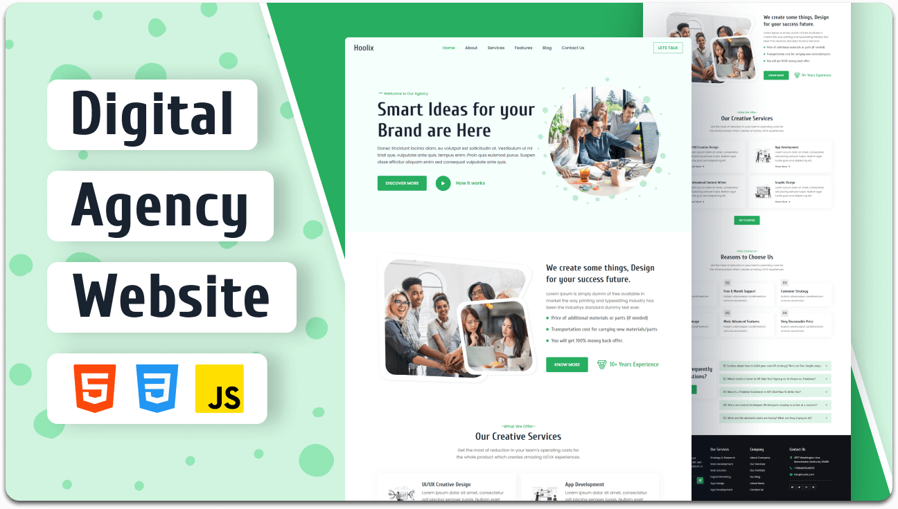

# Quantam Play — Creative Digital Agency Website

[](https://developer.mozilla.org/en-US/docs/Web/HTML)
[](https://developer.mozilla.org/en-US/docs/Web/CSS)
[](https://developer.mozilla.org/en-US/docs/Web/JavaScript)
[](https://developer.mozilla.org/en-US/docs/Learn/CSS/CSS_layout/Responsive_Design)
[](./README.md#license)

> **Quantam Play** is a modern, high-performance digital agency web platform tailored for creative studios, product design agencies, tech innovators, and media enterprises. Featuring clean typography, balanced micro-interactions, responsive UI components, and accessible contact infrastructure.

---

## 📌 Table of Contents

- [Overview & Vision](#-overview--vision)
- [Website Preview](#-website-preview)
- [Key Features](#-key-features)
- [Services Portfolio](#-services-portfolio)
- [Official Contact & Location Details](#-official-contact--location-details)
- [Design System & Tokens](#-design-system--tokens)
- [Project Architecture](#-project-architecture)
- [Getting Started & Local Development](#-getting-started--local-development)
- [SEO & Structured Data](#-seo--structured-data)
- [Customization Guide](#-customization-guide)
- [Browser Compatibility](#-browser-compatibility)
- [License](#-license)

---

## 🌟 Overview & Vision

**Quantam Play** serves as a premier showcase platform designed to position digital agencies at the forefront of their industry. With a "design-first, performance-always" philosophy, the project is crafted using pure semantic **HTML5**, standard **Vanilla CSS3**, and lightweight **Vanilla JavaScript** without heavy framework dependencies.

### Core Strengths:
* **Instant Load Times**: Zero bundler overhead or runtime bloat ensures lightning-fast first contentful paint (FCP).
* **Cross-Device Fluidity**: Seamless user experience from 320px mobile screens to ultra-wide 4K desktop monitors.
* **Conversion-Driven Layout**: Clear call-to-actions, service showcases, social proofs, interactive FAQs, and multi-channel contact touchpoints.

---

## 🖼️ Website Preview



---

## ✨ Key Features

- **📱 100% Fully Responsive Layout**: Built with flexible CSS Grid, Flexbox, and calibrated media queries for mobile, tablet, and desktop viewports.
- **🧭 Sticky Dynamic Header**: Automatically tracks scroll depth and transitions from transparent to solid background with subtle elevation shadow (`header.active`).
- **🍔 Mobile Navigation Drawer**: Off-canvas sliding menu with backdrop overlay blur and automatic close-on-link-click behavior.
- **🎨 Curated Aesthetics**: Professional dark/light mode balance utilizing deep slate tones, vibrant brand green (`#27AE60`), and crisp typography.
- **❓ Interactive FAQ Accordion**: Expandable Q&A section powered by lightweight JavaScript toggling for smooth user query resolution.
- **📞 Multi-Channel Contact Structure**: Comprehensive contact section providing both **Primary** headquarters and **Alternative** studio locations, direct WhatsApp/phone lines, and departmental email channels.
- **🔍 SEO & Social Ready**: Equipped with Open Graph tags, Twitter card metadata, and Schema.org `Organization` JSON-LD structured data.

---

## 🛠️ Services Portfolio

Quantam Play offers full-cycle digital development and creative design services:

| Service | Description | Highlights |
| :--- | :--- | :--- |
| **UI/UX Creative Design** | Human-centered product design, wireframing, and interactive prototyping. | Design systems, user journeys, accessibility testing. |
| **App Development** | Scalable mobile and web applications built for speed and usability. | Cross-platform compatibility, clean code architecture. |
| **Professional Content Writing** | Compelling brand storytelling, SEO copywriting, and content marketing. | High-converting copy, brand voice definition. |
| **Graphic Design & Branding** | Distinctive visual identities, logo marks, and marketing collateral. | Vector graphics, brand guidelines, asset suites. |
| **Strategy & Research** | Market analysis, user interviews, and digital roadmap formulation. | Competitive benchmarking, data-backed insights. |
| **Digital Marketing** | Targeted growth campaigns, conversion optimization, and brand positioning. | Analytics tracking, organic & paid growth strategy. |

---

## 📞 Official Contact & Location Details

To ensure clear communication for clients and partners worldwide, **Quantam Play** maintains primary headquarters and alternative studio facilities:

| Communication Channel | Primary Details | Alternative / Secondary Details |
| :--- | :--- | :--- |
| **🏢 Physical Address** | **Headquarters (HQ):**<br>1024 Quantum Blvd, Suite 500<br>Austin, TX 78701, USA | **Alternative Studio Hub:**<br>4517 Washington Ave, 2nd Floor<br>Manchester, KY 39495, USA |
| **📞 Telephone Lines** | **Main Office Line:**<br>[+1 (555) 234-5678](tel:+15552345678) | **Direct Support & WhatsApp:**<br>[+1 (555) 876-5432](tel:+15558765432) |
| **✉️ Email Addresses** | **General Inquiries:**<br>[info@quantamplay.com](mailto:info@quantamplay.com) | **Client Support & Helpdesk:**<br>[support@quantamplay.com](mailto:support@quantamplay.com) |
| **⏰ Business Hours** | **Monday – Friday:**<br>9:00 AM – 6:00 PM (EST) | **Saturday Support:**<br>10:00 AM – 2:00 PM (EST) *(Sunday Closed)* |
| **🌐 Social Profiles** | Facebook, Twitter/X, Instagram, LinkedIn, Pinterest | Available in website footer |

---

## 🎨 Design System & Tokens

Defined inside [assets/css/style.css](file:///c:/Users/QBS%20Accounting/Documents/websites/Quantam-Play/assets/css/style.css):

### Color Palette
- **Brand Primary Green (`--go-green`)**: `hsl(145, 63%, 42%)` / `#27AE60`
- **Rich Dark Background (`--rich-black-fogra-29-1`)**: `hsl(215, 31%, 14%)`
- **Deep Navy (`--rich-black-fogra-29-2`)**: `hsl(230, 14%, 8%)`
- **Granite Gray Body (`--granite-gray`)**: `hsl(0, 0%, 40%)`
- **Pure White (`--white`)**: `hsl(0, 0%, 100%)`
- **Cultured Gray (`--cultured`)**: `hsl(0, 0%, 93%)`

### Typography
- **Headings & Logo Brand**: `'Cuprum', sans-serif` (Weights: 500, 600, 700)
- **Body & Paragraphs**: `'Poppins', sans-serif` (Weights: 400, 500, 600)

### Elevations & Shadows
- `--shadow-1`: `3px 4px 30px hsla(0, 0%, 53%, 0.1)`
- `--shadow-2`: `5px 3px 40px hsla(191, 100%, 17%, 0.1)`

---

## 📂 Project Architecture

```plaintext
Quantam-Play/
├── assets/
│   ├── css/
│   │   └── style.css            # Complete design system, resets, components, and media queries
│   ├── images/
│   │   ├── about-banner.png     # Visual illustration for About section
│   │   ├── hero-banner.png      # High-resolution hero banner asset
│   │   ├── hero-pattern.svg     # Decorative background SVG vector
│   │   ├── service-1.png        # UI/UX Creative Design card icon
│   │   ├── service-2.png        # App Development card icon
│   │   ├── service-3.png        # Content Writer card icon
│   │   └── service-4.png        # Graphic Design card icon
│   └── js/
│       └── script.js            # Mobile navbar toggle, scroll listener, and accordion logic
├── readme-images/
│   └── desktop.png              # Website desktop mockup preview image
├── favicon.svg                  # SVG brand vector icon
├── index.html                   # Semantic markup, meta tags, and structured data
├── index.txt                    # Plaintext content outline and copy reference
├── style-guide.md               # Design tokens, color definitions, and font specifications
└── README.md                    # Project documentation and developer reference
```

---

## 🚀 Getting Started & Local Development

This project requires **no build tools, compilers, or package managers**. You can run it immediately on any device or hosting server.

### Option 1: Direct Browser Launch
1. Clone or download the repository to your local computer:
   ```bash
   git clone https://github.com/your-username/Quantam-Play.git
   ```
2. Navigate to the project root folder.
3. Double-click [index.html](file:///c:/Users/QBS%20Accounting/Documents/websites/Quantam-Play/index.html) to open it in your default web browser.

### Option 2: Using VS Code Live Server
1. Open the folder in Visual Studio Code.
2. Install the **Live Server** extension (by Ritwick Dey).
3. Right-click on [index.html](file:///c:/Users/QBS%20Accounting/Documents/websites/Quantam-Play/index.html) and select **"Open with Live Server"**.

### Option 3: Using Python Local Server
```bash
# Python 3.x
python -m http.server 3000
```
Open your browser and navigate to `http://localhost:3000`.

### Option 4: Using Node.js (npx)
```bash
npx serve .
# or
npx http-server -p 8080
```

---

## 🔍 SEO & Structured Data

The website is optimized for search indexing and social sharing:
- **Canonical Meta Tags**: Accurate `<title>`, description, and keyword tags.
- **Open Graph & Twitter Cards**: High-impact preview cards for Facebook, LinkedIn, Twitter, and messaging apps.
- **Schema.org Structured Data**: Integrated JSON-LD schema providing search engines with structured organization info, dual-office addresses, and customer support contact points.

---

## ⚙️ Customization Guide

1. **Brand Identity**:
   - Update text occurrences of `Quantam Play` in [index.html](file:///c:/Users/QBS%20Accounting/Documents/websites/Quantam-Play/index.html).
   - Update [favicon.svg](file:///c:/Users/QBS%20Accounting/Documents/websites/Quantam-Play/favicon.svg) with your custom logo shape or brand color.

2. **Contact Information**:
   - Update phone links (`tel:+1...`) and email links (`mailto:...`) in the footer section of [index.html](file:///c:/Users/QBS%20Accounting/Documents/websites/Quantam-Play/index.html).

3. **Color Scheme**:
   - Modify the CSS variables inside `:root` in [assets/css/style.css](file:///c:/Users/QBS%20Accounting/Documents/websites/Quantam-Play/assets/css/style.css) to apply your custom brand palette.

---

## 🌐 Browser Compatibility

Quantam Play is tested and fully compatible with all modern browsers:
- **Google Chrome** (v90+)
- **Mozilla Firefox** (v88+)
- **Apple Safari** (v14+)
- **Microsoft Edge** (v90+)
- **Mobile Browsers** (Chrome Mobile, Safari iOS, Samsung Internet, Opera Mobile)

---

## 📄 License

This project is licensed under the **MIT License**. You are free to modify, distribute, and utilize it for commercial or personal projects.

**Quantam Play** — *Smart Ideas for your Brand are Here.*
